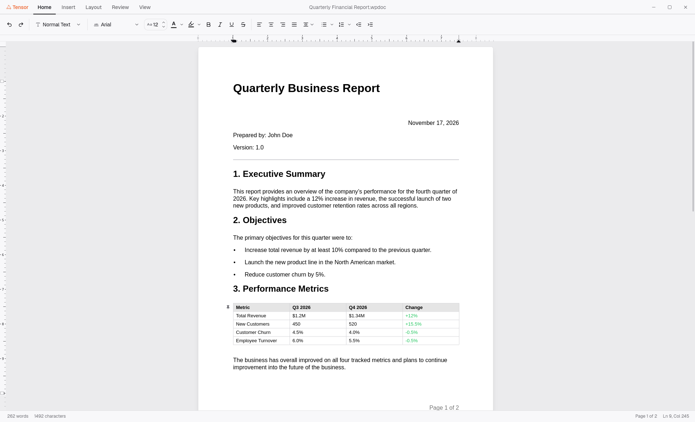

<div align="center">


<br />
    
[](https://github.com/ccaidenm/tensor/stargazers)
[](https://github.com/ccaidenm/tensor/releases)
[](LICENSE)

</div>   

A free, open-source word processor focused on privacy, modern UI, and power-user features.

## Quick Start

Download the installer for your platform from [**Releases**](https://github.com/ccaidenm/tensor/releases) (Windows 10+, macOS 10.15+, and Linux) then install and start writing. No account, no sync, no telemetry.

Building from source? See [CONTRIBUTING.md](CONTRIBUTING.md#development-setup) — or get started in three lines:

```bash
git clone https://github.com/ccaidenm/tensor.git
cd tensor && npm install
npm run tauri dev
```

## Features
Tensor's goal is to rival mainstream word processors with a smaller system footprint, a better user experience, modern UI, and a privacy-focused architecture. Its feature set includes:

* **Formatting:** Headings, custom styles, bundled and external fonts, rulers, line numbers.
* **Pagination:** A custom pagination engine built from ProseMirror handling sections, columns, headers & footers (bands), page numbers, and per-page, per-section, and per-document setup.
* **Tables:** Full table editing plus reusable, auto-updating reference tables (Table of Contents, Index, and friends).
* Editing: The essentials: spell & grammar check, find & replace, translate, statistics.
* **Interoperability:** Import and edit DOCX and Markdown directly; export to DOCX, Markdown, and PDF.
* **Power-user:** Fully rebindable keyboard shortcuts, a command palette, focus mode, dark & light modes, and customizable UI.
* **Accessibility:** Built-in accessibility checker and keyboard-first design in the editor.
* **Forgotten essentials:** Equations, images, watermarks, threaded comments, and [more](docs/README.md).

<br />



## Resources
* 📖 **Documentation:** [docs/README.md](docs/README.md) — start here
* 🌎 **Translate Tensor:** Open a PR — Weblate support planned soon
* 🛠️ **Contributing:** [CONTRIBUTING.md](CONTRIBUTING.md) — dev setup, conventions, PRs
* 🗺️ **Roadmap:** [ROADMAP.md](ROADMAP.md) — what's next in development
* 📋 **Changelog:** [CHANGELOG.md](CHANGELOG.md)
* 🤝 **Code of Conduct:** [CODE_OF_CONDUCT.md](CODE_OF_CONDUCT.md)

## Contributors
<a href="https://github.com/ccaidenm/tensor/graphs/contributors">
  
</a>

## License
Tensor is free software licensed under the GNU Affero General Public License v3.0. See [LICENSE](LICENSE) for details.
