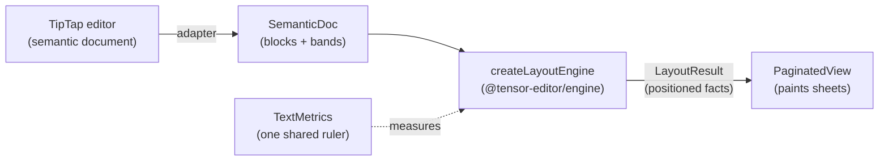

# Architecture

Tensor is one app made of three layers: an editor that knows what your document *means*, a layout engine that knows where everything *sits*, and an app shell that ties them to the desktop. This page is the mental model; the other concept pages zoom into each layer.

## The three layers

| Layer | Where | What it owns |
|---|---|---|
| App shell | `src-tauri/` | The Tauri window, file dialogs, native print, filesystem access, plugins. No document logic. |
| Document editor | `src/lib/editor/` | TipTap and ProseMirror: what the text *is* -- paragraphs, runs, marks, custom extensions. Never computes layout. |
| Pagination engine | `packages/engine/` | A headless, dependency-free layout package. Takes a semantic document, returns positioned geometry: which line on which page, at which coordinates. Never paints. |

The boundary is strict: the engine computes but never paints, and the shell paints but never computes. Between them flows pure data. The editor hands the engine a `SemanticDoc`; the engine hands the view a `LayoutResult` of line boxes, page geometry, and band echoes.

Two rules make that boundary hold:

- **One ruler.** A single `TextMetrics` instance measures text everywhere, so layout, painting, and caret placement all agree: nothing measures twice.
- **Input-only view.** The hidden editing surface is for input only. Questions like "which glyph is under this pixel?" are answered from the engine's positioned facts, not by re-measuring DOM.

## Subsystems

| If you want to know… | Read |
|---|---|
| How the engine breaks lines, places blocks, and caches incremental edits | [`packages/engine/ARCHITECTURE.md`](../../packages/engine/ARCHITECTURE.md) -- the detailed spec |
| Why the engine is a separate pure package | [The pagination engine](pagination-engine.md) |
| What lives inside a saved document | [The file format](file-format.md) |
| How accessibility is wired through all three layers | [Accessibility model](accessibility.md) |
| Where every setting lives | [Configuration](../reference/configuration.md) |
| How translations are structured | [Internationalization](../i18n.md) |
