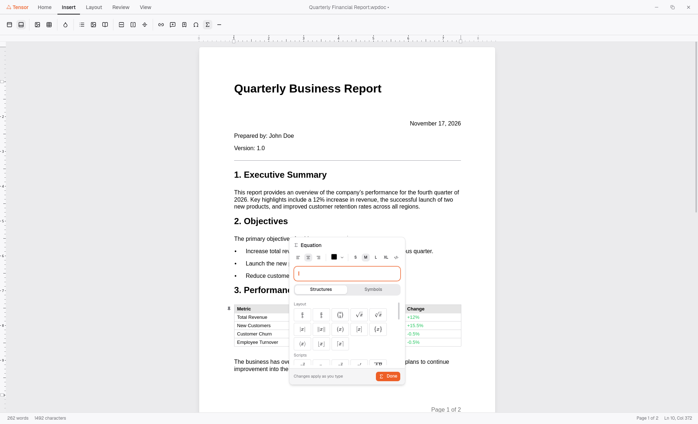

# Equations

Equations are blocks of rendered math, written in LaTeX and typeset by KaTeX. Tensor stores the LaTeX source; what you see is a rendering of it, so the source is the whole truth about the equation.

## Insert an equation

Press <kbd>Alt</kbd>+<kbd>=</kbd>, or open the **Insert** tab and click the **Equation** button. An equation block appears at the caret with its editor open.

Equations are display blocks -- centered paragraphs of their own. Tensor has no inline math yet: an equation cannot sit inside a sentence.

<!-- SHOT: equations/editor-bubble.png | Show: equation editor bubble open: visual math field with placeholder text, LaTeX source mode toggle, align buttons, color, S/M/L/XL scale presets -->

## Write the math

The editor bubble has two ways in:

- **Visual editing** -- the field renders as you type, and the **Structures** and **Symbols** palettes below it insert fractions, roots, scripts, brackets, and operators by click.
- **Source mode** -- the toggle switches to a plain LaTeX field. The placeholder shows the shape: `\frac{a}{b} \cdot x^{2}`.

Both write the same LaTeX, and every change applies as you type -- **Done** closes the editor. A few constructs cover most formulas:

| Want | Type |
|---|---|
| `a/b` as a fraction | `\frac{a}{b}` |
| Superscript, subscript | `x^{2}`, `x_{i}` |
| Square root | `\sqrt{x}` |
| Greek letters | `\alpha`, `\beta`, `\pi` |
| Sum with limits | `\sum_{i=1}^{n}` |
| Multiplication dot | `\cdot` |

Invalid LaTeX is not an error state: the block shows the raw source until the input parses again. An empty equation shows a dashed placeholder, and **Done** commits what's there.

## Size, alignment, color

The bubble's controls sit beside the field:

- **Scale** presets S, M, L, XL set the equation's font size. Scale is real layout data -- changing it re-measures and re-paginates the document.
- **Alignment** (left, center, right) positions the block on its line. Center is the default.
- **Color** tints the rendered math. It is presentation-only: it never affects layout.

## How equations sit on the page

An equation is one placement unit: it never splits across a page break. A formula taller than the page's text area cannot be placed at any size -- rather than shrink the math, the paginated view falls back to rendering that equation natively at natural size. A formula wider than the text area is allowed to bleed into the margins.

Under the rendering there is a second copy of the math as real text: selectable, searchable, and readable by screen readers.
