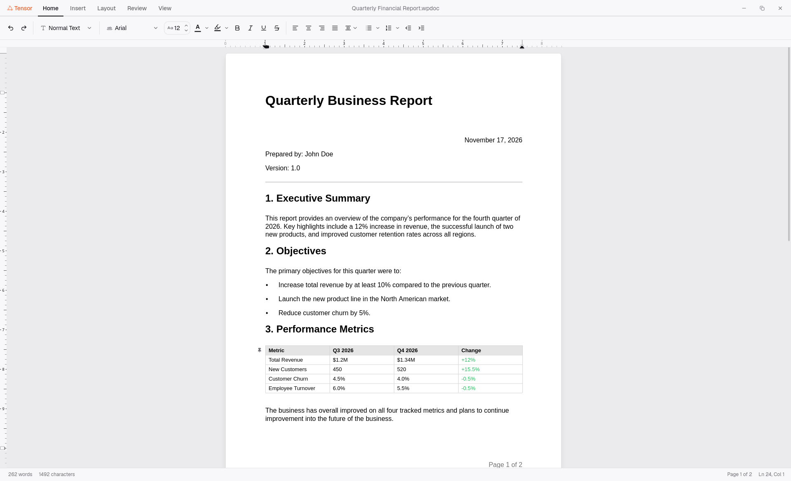
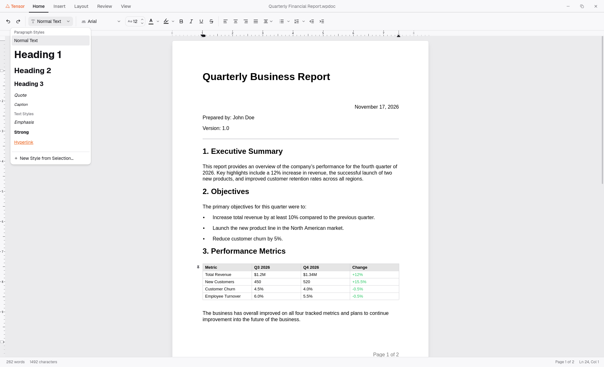

# Formatting

Tensor formats text through **styles**: a paragraph or a selection carries a style name, and the style carries the formatting. Change the style, and every paragraph using it updates. Direct formatting (bold, font size) still works on top of any style.

<!-- SHOT: formatting/ribbon-home.png | Show: Home tab active on a formatted document: styles picker (Normal Text), font family (Arial), size, color, highlight, B/I/U/S, alignment, line spacing, lists, indents -->

## Apply a style

Put the caret in the paragraph (or select the text), open the styles gallery on the Home tab, and pick a style.

<!-- SHOT: formatting/styles-gallery.png | Show: Home tab, styles gallery dropdown open: Paragraph Styles (Normal Text, Heading 1-3, Quote, Caption), Text Styles (Emphasis, Strong, Hyperlink), New Style from Selection -->

| Style | Kind | What it does |
|---|---|---|
| Normal Text | Paragraph | The document's base style; the picker's reset. |
| Heading 1-3 | Paragraph | 32 / 24 / 19 px, bold, and kept together with the following block across page breaks. |
| Heading 4-6 | Paragraph | Keyboard-only: <kbd>Ctrl</kbd>+<kbd>Alt</kbd>+<kbd>4</kbd>…<kbd>6</kbd>. Same keep-with-next rule as Heading 1-3. |
| Quote | Paragraph | Italic block. |
| Caption | Paragraph | 12 px italic -- the Table of Figures reads captions from any paragraph with this style. |
| Emphasis, Strong | Text | Italic and bold character styles. |
| Hyperlink | Text | Orange underlined text; links get it automatically. |

Headings matter beyond looks: the Table of Contents builder reads Heading 1-6, and the DOCX export maps each heading to its Word level.

## Custom styles

The gallery's last entry, **New Style from Selection…**, turns formatted text into a reusable style: select text that looks the way you want, run it, name the style, and it appears in the gallery for the whole document. Custom styles survive in the `.wpdoc` file and travel through DOCX export.

Styles can also live outside any document: a global `styles.json` (edited in the Style dialog's manager) merges over the built-ins, and per-document definitions win over both. Delete a custom style from the same dialog; paragraphs using it fall back to Normal Text.

## Fonts

The font picker on the Home tab lists every installed family, with a **recently used** section at the top.

| Source | What ships | Notes |
|---|---|---|
| Bundled | Geist (the UI font), Open Sans, Lora, Playfair Display, JetBrains Mono, Source Serif 4, Merriweather, Fira Code, Nunito, Crimson Pro, IBM Plex Sans, Manrope, Sora | Always available; per-face files, so bold and italic are real, not synthesized. |
| System | System UI, Arial, Georgia, Times New Roman, Courier New, Verdana | Resolved by the OS. |
| Uploaded | Anything you add | Copied into Tensor's data folder, never referenced in place; registered immediately. |
| Catalogs | Google Fonts, Fontshare | Hidden behind a setting that no network code reads yet -- catalogs are not wired up. |

Upload your own from the font picker's menu: pick a `.ttf`/`.otf` (regular, bold, italic, bold-italic), and Tensor registers the faces and re-flows the document. Fonts print and export like any other.

The document's default font and size live in Settings -- they seed every new document.

## Rulers

Toggle both rulers from the View tab's **Show Rulers** button. The horizontal ruler shows the page's margins as draggable stops; drag a margin marker to reshape the text area, or drag the indent markers to set the paragraph indent. The vertical ruler mirrors page height.

The units on the ruler follow the measurement unit setting (inches, centimeters, millimeters, points, or picas), configurable in Settings.

## Line numbers

Line numbers are a **Layout tab** control, not a view toggle: the Line Numbers button writes the setting into the document, so it prints and opens the same everywhere. Modes cover off, continuous, and restart-per-page; the gutter renders in the paginated view's left margin.
