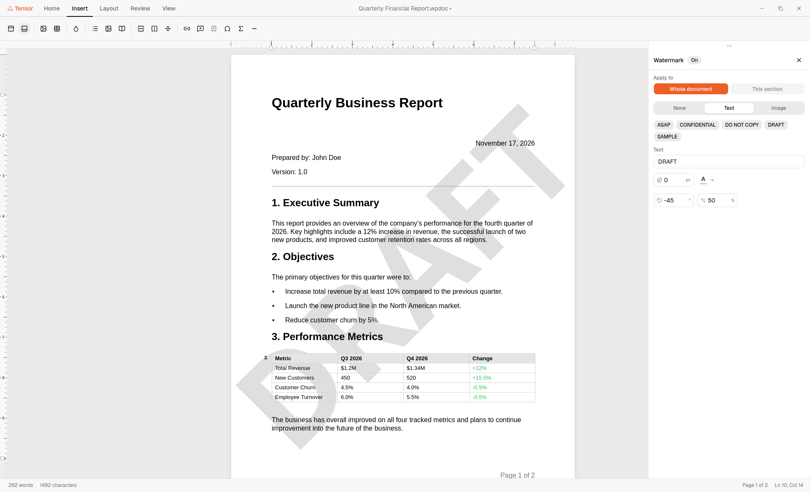

# Images

Images live in two shapes: **block images** (their own paragraph, resizable, wrappable) and **inline images** (inside a line of text). Both are stored by content: every image's bytes are hashed once, the document keeps a `media://` reference, and identical images share one copy.

## Insert an image

Open the **Insert** tab and click **Image**. Pick a file, and Tensor decodes its natural size and places it as a block image at the caret.

Paste and drag-and-drop land in the same pipeline: paste an image from the clipboard, or drop a picture file onto the page, and it goes through the same hashing and insert step. There is no separate paste flow to learn.

Tensor's insertion pipeline is local: the picker reads files you hand it, pasted images arrive as bytes from the clipboard, and Markdown import refuses remote image URLs rather than downloading them.

## Resize and move

Click an image to select it. Each corner drags its own edges while the opposite corner stays anchored:

- Dragging resizes with the aspect ratio locked.
- Hold <kbd>Shift</kbd> while dragging for a free resize.
- A drag can pass the anchored corner; both dimensions clamp at a small floor instead of flipping.

To let text flow around an image, drag it onto the paragraph: an unfloated image floats on drop, positioned relative to its text anchor, and the engine clamps it to the page. Drag it again to reposition.

## Right-click controls

The context menu on an image carries the rest:

| Item | What it does |
|---|---|
| Add Caption | Inserts a Caption-styled paragraph directly below the image and focuses it. The image and the caption's first line share a page -- a caption never strands on the next page alone. |
| Alt Text | Opens the Alt Text dialog: a description for screen readers, plus a **Mark as decorative** switch. The two are exclusive -- decorative images are skipped by screen readers. |
| Wrap Inline | Converts a block image to inline, so it sits within a line of text. |
| Wrap Front / Wrap Behind | Layers the image over or under the text. |
| Align Left / Center / Right | Block images only. |
| Corner radius | A set of presets, from square to fully rounded. |
| Delete Image | Removes the image. |

Captions feed the Table of Figures: any paragraph with the Caption style is readable by the ToF generator even when captions are hidden. The View tab's **Show Captions** toggle is presentation-only -- it never changes what the document stores.

## Watermarks

Watermarks live on the **Insert** tab's **Watermark** button (you insert one). It opens a docked panel that writes live: every control commits as you touch it, and the page behind the panel is the preview.

Two tabs hold the controls, **Text** and **Image**, plus a **None** tab that removes the watermark:

- **Text** -- type any wording, or use the preset chips: ASAP, CONFIDENTIAL, DO NOT COPY, DRAFT, SAMPLE. Color, rotation, opacity, and scale adjust beneath.
- **Image** -- pick a picture, and the same rotation and opacity controls apply.

The panel's scope switch, **Whole document / This section**, decides whether the watermark applies everywhere or only to the section the caret is in -- a section-scoped watermark writes that section's settings, not the document's.

The View tab's **Show Watermarks** toggle hides watermarks without deleting them (a display switch, not a document change).

<!-- SHOT: images/watermark-panel.png | Show: Watermark panel docked right, Text tab, DRAFT preset chip active, the page behind showing the watermark -->
