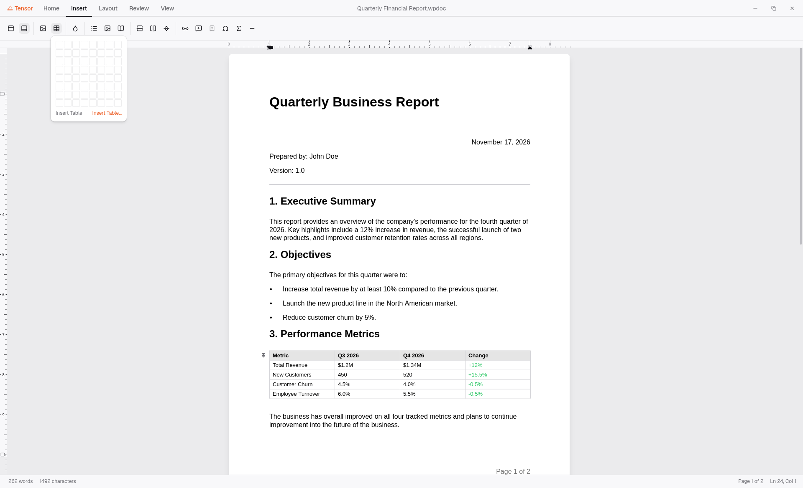
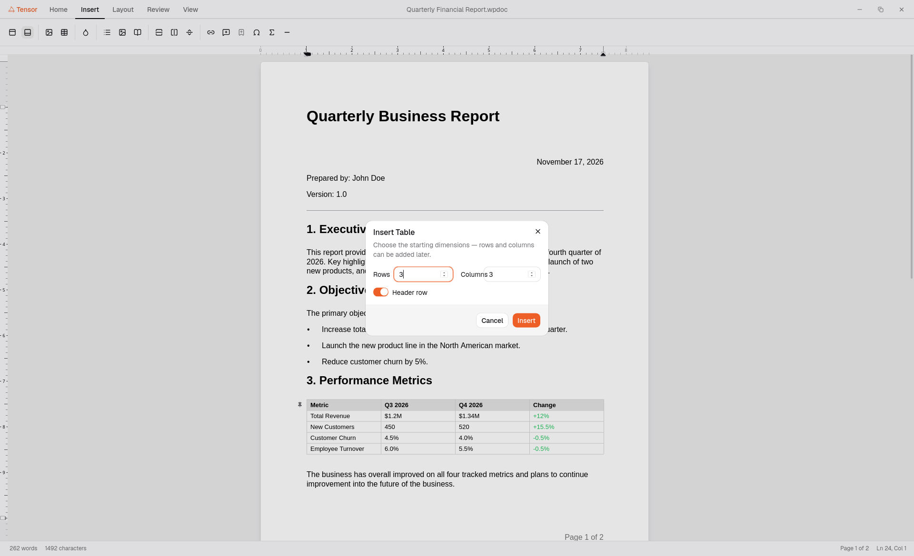

# Tables

## Insert a table

Put the caret where the table goes, open the **Insert** tab, and click the **Table** button. The grid picker drops down: hover to size the table (up to 8 × 8), then click to insert it. For anything bigger or more precise, click **Insert Table…** instead.

<!-- SHOT: tables/insert-table-grid.png | Show: Insert tab, table grid picker dropdown open showing the 8x8 hover grid and the Insert Table / Insert Table... actions -->

The dialog takes starting dimensions and nothing else:

<!-- SHOT: tables/insert-table-dialog.png | Show: Insert Table dialog: Rows spinner (3), Columns spinner (3), Header row toggle on, Cancel/Insert buttons -->

| Control | Default | Notes |
|---|---|---|
| Rows | 3 | 1-99 |
| Columns | 3 | 1-99 |
| Header row | on | The first row is a real header: it repeats on page breaks and feeds the Table Panel's header controls. |

Rows and columns can be added later -- the dialog sizes the table, it doesn't cap it. The command palette inserts tables too: type the dimensions as **rows × columns** and run it -- `4x3` inserts a table of four rows and three columns. `7x2`, `12 x 12`, and `4×4` all parse the same way. Inserting while inside a table adds the new table *after* the one you're in -- tables never nest.

Header rows are signified by a pin icon in the left gutter of the document.

## Edit a table

Click into any cell and type. <kbd>Tab</kbd> moves to the next cell (and adds a row at the end), <kbd>Shift</kbd>+<kbd>Tab</kbd> goes back. With the caret inside a table, a **Table** contextual tab appears in the ribbon, and the Table Panel -- opened from that tab -- carries the table's controls:

| Panel section | Controls |
|---|---|
| Table summary | The live size: rows × columns. |
| Table flow | Align left / center / right; border presets. |
| Columns | Per-column width. |
| Rows | Per-row height, and how each row may break across pages. |
| Pagination | Keep-with-next and repeat-header behavior. |
| Header row | **Make header row** pins the row the caret is in; it repeats on every page the table touches, Word-style. |

Column edges drag to resize; the header row stays pinned visually while you scroll a long table.

Select two or more cells (drag across them) and the floating toolbar shows **Merge Cells** -- click it to join them into one cell. With a merged cell selected, the same button reads **Split Cells** and returns each part to its own cell. The button only appears when the selection spans multiple cells, so ordinary selections never see it.

## Reference tables

Reference tables are generated views over the document's headings and captions, not hand-built content. All three live on the **Insert** tab's reference-tables group:

| Entry | Built from | Options at insert time |
|---|---|---|
| Table of Contents | Heading 1-6 | Depth: which heading levels to include (1-6, default 3 = H1-H3). |
| Table of Figures | Paragraphs styled **Caption** | -- |
| Index | Marked terms | -- |

Each inserts as a block the generator owns: edit the document and the entries follow -- renumber, add a heading, delete a section, and the table updates. They re-flow with the pagination engine like any other block, and the Markdown export skips them deliberately (entries are derived content; see [import and export](import-export.md)).

The Table of Contents dialog's depth choice is the only insert-time option it has -- everything else about a ToC is derived.
