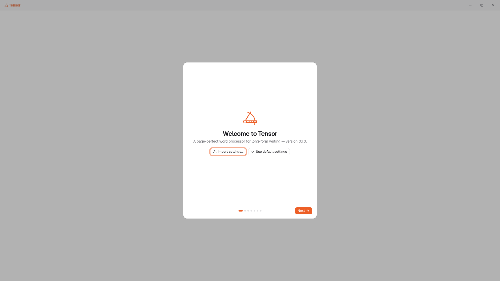
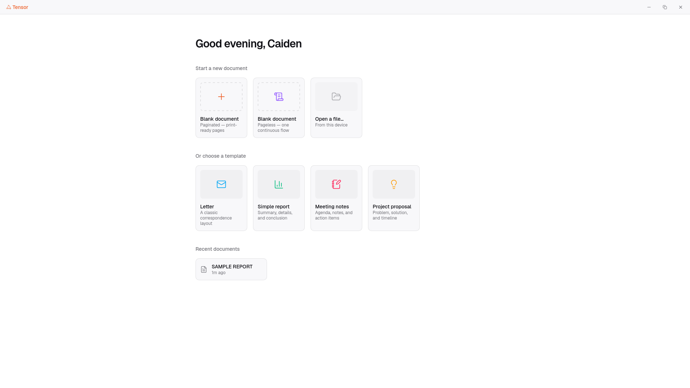

# Getting started

This tutorial takes you from download to a saved Tensor document. Every step ends with something visible on screen: if that doesn't happen, this page tells you what should have.

## Install

Tensor runs on Linux, macOS, and Windows. Download the build package for your system from the [releases page](https://github.com/ccaidenm/tensor/releases) and install it like any other app: open the file, follow the installer's steps, launch Tensor from your applications menu.

| System | Package |
|---|---|
| Linux | `.deb`, `.rpm`, or `.AppImage` |
| macOS | `.dmg` |
| Windows | `.msi` or installer `.exe` |

<!-- TODO(verify): no releases are published yet (checked 2026-11-22); this section
     documents the intended user flow. Confirm the artifact list matches what the
     release actually ships before publishing the docs. -->

## First launch

The Start Screen opens: your documents live here once you have some.

On first launch, a setup wizard walks through seven quick choices: welcome, appearance (your name, accent, theme), how you like to write, spell check, translation, privacy, and accessibility. Every step commits as you go, and going Back revisits the already-saved choice. Not sure about spell check or translation? Skip is fine; they stay off until you turn them on, and the wizard never nags again. (Spell and translation setup reopen any time from **Review → Spelling & Grammar** and **Review → Translate**.)

<!-- SHOT: getting-started/setup-wizard.png | Show: Setup Wizard welcome step over the Start Screen, step dots visible -->

## Write your first document

Open a new document with <kbd>Ctrl</kbd>+<kbd>N</kbd> (or **New document** on the Start Screen). A blank sheet appears in **Pages** mode: one white sheet on a desk-like backdrop. If you prefer a single continuous surface without page breaks, choose **Pageless** at the wizard's "How do you like to write?" step, or flip any time from the View tab.

Type a line of text. Press <kbd>Enter</kbd>, type another. Formatting basics: select text and press <kbd>Ctrl</kbd>+<kbd>B</kbd> for bold, <kbd>Ctrl</kbd>+<kbd>I</kbd> for italic. Success: your text renders on a paginated sheet, and the status bar shows a page count.

## Save it

Press <kbd>Ctrl</kbd>+<kbd>S</kbd>. A new document has no file yet, so the save dialog opens with the file type set to **Tensor Document (\*.wpdoc)**. Pick a folder, name the file, save.

Success: the title bar shows your file name, and the Start Screen lists the document under recent files. `.wpdoc` is Tensor's own container format (see [the file format](concepts/file-format.md)), but everything exports to Word, Markdown, or PDF later, so nothing is locked in.

<!-- SHOT: getting-started/start-screen.png | Show: Start Screen with SAMPLE REPORT in the recent-documents list, wizard not visible -->

## Building from source

If you would like to build Tensor to debug, contribute, or audit, please follow the instructions in [CONTRIBUTING.md](../CONTRIBUTING.md)
